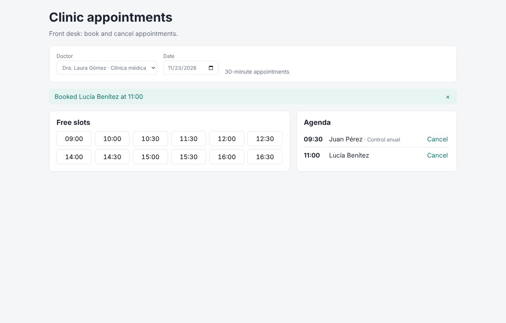
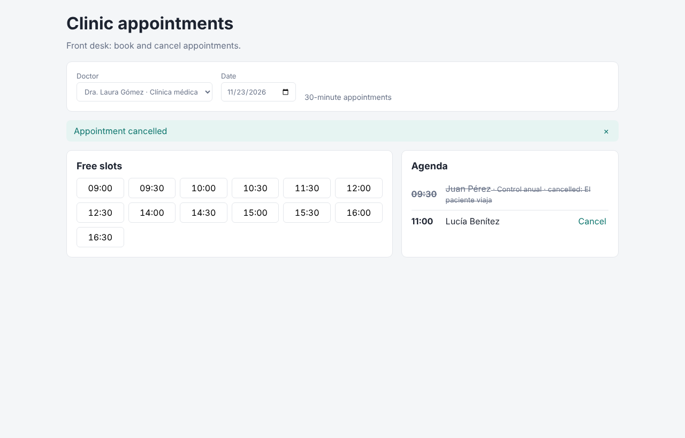

# Clinic Appointments

Appointment booking for a medical clinic: an **ASP.NET Core (.NET 10)** Web API with **Entity Framework Core** and **PostgreSQL**, and a **React + TypeScript** front-desk app. The scheduling rules (working hours, slot lengths, no double booking, cancellation notice) live in one service and are covered by integration tests with a frozen clock.



## Features

- Doctors with their own shifts (e.g. Mon-Fri 9-13 and 14-17) and appointment length (20, 30, 40 minutes…)
- Free slots per doctor and day, hiding past slots and lunch breaks
- Book by patient DNI, or register a new patient on the spot
- Rules enforced by the API:
  - only inside the doctor's shifts and aligned to a slot
  - in the future and at most 90 days ahead
  - one active appointment per doctor and slot, **guaranteed by a filtered unique index** in the database even if two requests arrive at once
  - a patient can't have two overlapping appointments, even with different doctors
  - cancellations at least 2 hours in advance; cancelled slots become free again
- Errors returned as RFC 9457 ProblemDetails (`400` invalid time, `404` unknown doctor/patient, `409` conflicts)
- OpenAPI document at `/openapi/v1.json`



## Tech stack

| Part | Choice |
| --- | --- |
| API | .NET 10, ASP.NET Core minimal APIs (route groups, typed results), built-in validation, ProblemDetails, OpenAPI |
| Data | Entity Framework Core 10, PostgreSQL (Npgsql); SQLite for zero-setup local runs and tests |
| Time | `TimeProvider` + clinic time zone, so tests can freeze and move time |
| Frontend | React 19, TypeScript, Vite |
| Tests | xUnit + `WebApplicationFactory` (18 tests), Vitest (5) |
| Delivery | Docker (SDK → ASP.NET runtime image, nginx), Docker Compose, GitHub Actions |

## Run it

```bash
docker compose up --build
# open http://localhost:8080
```

Without Docker (SQLite, demo doctors and patients are created on first run):

```bash
cd src/Clinic.Api && dotnet run            # API on :5000
cd web && npm install && npm run dev       # React on :5173, proxies /api to :5000
```

## End-to-end tests

`e2e/` drives the real app in Chromium with [Playwright](https://playwright.dev). It starts the ASP.NET Core API on a fresh SQLite file (demo doctors and patients) and the Vite dev server, then checks:

- free slots follow each doctor's schedule: 30-minute slots with a lunch break, 20-minute slots for the paediatrician, none on days a doctor doesn't work;
- booking an existing patient found by DNI, and registering a new patient in the middle of a booking;
- cancelling asks for a reason, shows it in the agenda and frees the slot again;
- **two receptionists racing for the same slot** (two browser sessions): one gets it, the other gets a clear "already booked" error and a refreshed list.

```bash
cd e2e && npm ci && npx playwright install chromium
npx playwright test            # or: CHROME_PATH=/usr/bin/google-chrome npx playwright test
```

CI runs them after the unit tests and uploads the HTML report (with traces) when something fails.

## API

| Method | Path | Description |
| --- | --- | --- |
| GET | `/api/doctors?specialty=` | Doctors |
| GET | `/api/doctors/{id}/availability?date=2026-11-24` | Free slots that day |
| GET | `/api/patients?dni=&name=` | Search patients |
| POST | `/api/patients` | `fullName`, `dni` (7-8 digits), optional `email`, `phone` |
| GET | `/api/appointments?doctorId=&patientId=&date=&status=` | Agenda |
| POST | `/api/appointments` | `doctorId`, `patientId`, `startsAt` (clinic local time), optional `reason` |
| POST | `/api/appointments/{id}/cancel` | Optional `reason` |

## Design decisions

- **One place for the rules.** `SchedulingService` holds availability, booking and cancellation logic; endpoints only translate HTTP to calls. Slot generation is a pure static function with its own unit tests.
- **Check, then let the database have the last word.** The service checks availability for a friendly error, and a unique index filtered to active appointments (`"Status" = 'Scheduled'`) makes double booking impossible under concurrency.
- **Time is injected.** Business rules depend on "now"; `TimeProvider` lets the tests freeze the clock at Monday 08:00 and move it forward to test the cancellation window and past slots.
- **Local clinic time.** The clinic works in one time zone, so appointments are stored as local `timestamp without time zone`; "now" is converted to that zone in one place (`ClinicClock`).
- **Real HTTP integration tests.** `WebApplicationFactory` runs the whole app (routing, validation, error handling, EF Core) against a private in-memory SQLite database per test.

## Tests

```bash
dotnet test                 # 18 tests: API flows + slot generation
cd web && npm test          # 5 tests: error messages and date helpers
```

## Possible next steps

- Authentication for front-desk staff and doctors (ASP.NET Core Identity)
- EF Core migrations instead of `EnsureCreated`
- Email or WhatsApp reminders the day before

## License

MIT
